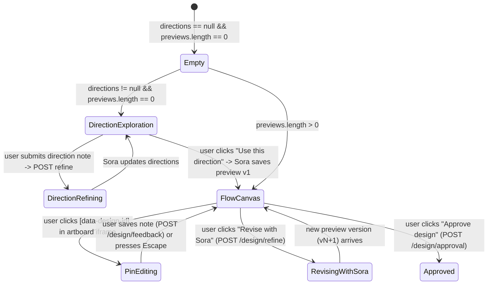

# UX contract — design-studio-canvas

The engineer builds exactly this. Anything not here is out of scope or a question.

## Scenarios
| # | Scenario | Pen frames (desktop dark / light · mobile dark / light) | Steps |
|---|---|---|---|
| S1 | Empty studio (before directions or previews exist) | Canvas empty state (`1440×900` dark/light · `390×844` dark/light) | User opens Design Studio when neither `directions` nor `previews` exist. Sees an honest empty state explaining that Sora proposes 2–4 style directions once Rena's brief is ready, with a link back to the chat. |
| S2 | Stage 1 — Visual Direction Exploration & Selection | Canvas with 2–4 Style-Tile Artboards (`1440×900` dark/light · `390×844` dark/light) | Sora calls `propose_directions`. `GET /api/sessions/:id/design` returns `directions`. The canvas renders one visual Style-Tile Artboard per direction (`palette` swatches with mono hex codes, `typography` specimen for `heading` + `body`, `layout` summary, `rationale`, `trade_offs`). User can pan/zoom, click **Revise direction** to leave feedback on a direction, or click **Use this direction** to instruct Sora to build the Design System and App Flow. |
| S3 | Stage 2 & 3 — Design System + Multi-Screen App Flow Canvas | Canvas with Design System Artboard + Flow Page Artboards (`1440×900` dark/light · `390×844` dark/light) | Once `previews` exist (authored by Sora as native OpenPencil `canvas.pen` scene graph), the 2D canvas renders: (a) the **Design System** artboard (token swatches `$color-*`, typography scale, spacing, and reusable component inventory), and (b) every **App Flow** screen artboard (`canvas.pen` vector frames, with legacy fallback for HTML) side-by-side. Top toolbar provides version pills (`v1`, `v2`), stage filter (`All boards` · `Directions` · `Design system` · `App flow`), device width (`390` · `768` · `1280`), and zoom controls (`-`, `100%`, `+`, `Fit`). |
| S4 | Stage 4 — Direct Click-to-Pin Feedback & Batch "Revise with Sora" | Canvas with active element highlight, floating pin popover, and bottom Revise bar (`1440×900` dark/light · `390×844` dark/light) | Clicking any element/component inside any artboard highlights the element, drops a pin at `(x, y)`, and opens an inline floating popover right next to the artboard/pin with the element's id slug (`font-mono`), a note textarea, and **Save note**. Saved open notes appear as numbered pins on the artboard, in the right rail, and in the bottom **Revise with Sora** bar (`N open notes · Revise with Sora`). Clicking **Revise with Sora** sends a consolidated revision message to Sora (`POST /chat/[id]/design/refine`). |
| S5 | Version Comparison, Publish Recovery & Handoff to Koda | Canvas header with version diff, publish retry banner, and Approve CTA (`1440×900` dark/light · `390×844` dark/light) | Switching between `v1` and `v2` updates all artboards and shows resolved notes (`Resolved in v2`). If `publish_error` is set and `published_url` is null, shows an inline warning banner with **Publish again**. Clicking **Approve vN** records approval (`POST /api/sessions/:id/design/approval`) so Sora creates the Koda handoff. |

## State machine

## Copy table (verbatim)
| Key | EN Text | ID Text | Where |
|---|---|---|---|
| `design_canvas_title` | `Design canvas` | `Kanvas desain` | Top bar title |
| `design_canvas_empty_title` | `No design boards yet` | `Belum ada papan desain` | Empty state heading |
| `design_canvas_empty_body` | `Once Rena's brief is ready, Sora proposes 2–4 visual directions here before building the design system and app pages.` | `Setelah ringkasan Rena siap, Sora akan mengajukan 2–4 arah visual di sini sebelum membuat sistem desain dan halaman aplikasi.` | Empty state body |
| `design_stage_all` | `All boards` | `Semua papan` | Canvas filter pill |
| `design_stage_directions` | `Directions` | `Arah gaya` | Canvas filter pill |
| `design_stage_system` | `Design system` | `Sistem desain` | Canvas filter pill |
| `design_stage_flow` | `App flow` | `Alur aplikasi` | Canvas filter pill |
| `design_zoom_in` | `Zoom in` | `Perbesar` | Canvas zoom toolbar |
| `design_zoom_out` | `Zoom out` | `Perkecil` | Canvas zoom toolbar |
| `design_zoom_fit` | `Fit` | `Paskan` | Canvas zoom toolbar |
| `design_direction_use` | `Use this direction` | `Gunakan arah ini` | Direction artboard primary button |
| `design_direction_feedback` | `Adjust direction` | `Sesuaikan arah` | Direction artboard secondary button |
| `design_system_board_title` | `Design system` | `Sistem desain` | Design System artboard header |
| `design_pin_placeholder` | `What should Sora change on this element?` | `Apa yang perlu Sora ubah pada elemen ini?` | Floating pin popover textarea |
| `design_pin_save` | `Save note` | `Simpan catatan` | Floating pin popover submit |
| `design_pin_cancel` | `Cancel` | `Batal` | Floating pin popover cancel |
| `design_revise_cta` | `Revise with Sora` | `Revisi bersama Sora` | Bottom revision bar CTA |
| `design_approve_cta` | `Approve design` | `Setujui desain` | Top bar approval CTA |
| `design_approved_badge` | `Approved · Handed to Koda` | `Disetujui · Diserahkan ke Koda` | Top bar approved pill |

## Data and events the UI depends on
| Need | Source (API / event / config) | Exists? |
|---|---|---|
| Preview versions (`version`, `direction_name`, `summary`, `pages`, `manifest`, `published_url`, `publish_error`) | `GET /api/sessions/:id/design` (`previews`) | Yes |
| Proposed style directions (`version`, `brief_version`, `directions[]` with `name`, `rationale`, `palette[]`, `typography`, `layout`, `trade_offs`) | `GET /api/sessions/:id/design` (`directions`) | **Add `directions` field to `StudioResponse` in `design_studio.rs`** |
| Open and resolved feedback items (`id`, `version`, `page`, `element_id`, `pin`, `level`, `body`, `status`, `resolution_note`, `resolved_in_version`) | `GET /api/sessions/:id/design` (`feedback`) & `POST /api/sessions/:id/design/feedback` | Yes |
| Design approval state (`version`, `approved_by`, `approved_at`) | `GET /api/sessions/:id/design` (`approval`) & `POST /api/sessions/:id/design/approval` | Yes |
| Retry publishing a version | `POST /api/sessions/:id/design/publish` | Yes |
| Pick a direction / send batch revision prompt to Sora | `POST /chat/[id]/design/refine` -> `POST /api/sessions/:id/messages` | Yes (in `frontend/`, add route in `frontend-new/`) |
| Serve sandboxed preview HTML/CSS/JS with `design_bridge.js` | `GET /design-preview/:token/*path` | Yes (in `frontend/`, add proxy route in `frontend-new/`) |

## Accessibility
- **Keyboard zoom & pan**: `+` / `=` zooms in, `-` zooms out, `0` resets to `100%`, `f` fits canvas, arrow keys pan the canvas when focus is on the canvas viewport, `Escape` closes any open pin popover or active element selection.
- **Focus order**: Top bar (Back to chat → Version pills → Stage filter → Device width → Publish/Approve actions) → Canvas artboards (Direction actions / Artboard headers / Pin badges) → Floating Pin Popover (Textarea → Save note → Cancel) → Bottom Revise with Sora bar → Right rail (Open notes / Resolved notes / Direction & Design System inspector).
- **Live regions**: Saving a note, sending a revision to Sora, retrying publish, or approving a version announces status via `aria-live="polite"`; errors announce via `role="alert"` only when non-empty.
- **Coarse pointer (`390px`)**: Touch targets on mobile artboard switcher, zoom buttons, pin badges, and bottom sheet controls are at least `44×44px` (`h-11`).

## Acceptance criteria
- [x] AC1: `GET /api/sessions/:id/design` returns `directions` (`Option<StudioDirectionSet>`) from `nomi_agent_core::design_directions::latest`, covered by Rust integration tests.
- [x] AC2: Stage 1 renders side-by-side visual Style-Tile Artboards from `directions` with live colour swatches (`palette` hex in `font-mono`), typography specimen (`heading` + `body`), layout, rationale, trade-offs, **Adjust direction** feedback, and **Use this direction** selection.
- [x] AC3: Stage 2 & 3 render the **Design System** artboard alongside all **App Flow** artboards on a 2D pan-and-zoom canvas (`25%`–`200%` + `Fit`) with device width presets (`390px`, `768px`, `1280px`), authored by Sora as native OpenPencil `canvas.pen` scene graph.
- [x] AC4: Stage 4 allows clicking any element in any artboard to open an inline pin comment popover without switching to a separate "Feedback mode" tab first, queues open notes, and submits a consolidated revision prompt via **Revise with Sora**.
- [x] AC5: Implemented in both `frontend/` and `frontend-new/`, passing `cargo test`, `messages.test.ts` (EN + ID parity), `classLint.test.ts` (strict token compliance), and `designStudio.test.ts`.
- [x] AC6: Pure OpenPencil Scene-Graph Canvas workflow: Sora authors `.pen` scene graphs (`canvas.pen`) instead of HTML; supported in backend `nomi-agent-core::design_artifact`, 60fps vector canvas rendering via `@open-pencil/core` / `@open-pencil/pen`, live design token variable inspection, automated design linting (`@open-pencil/core/lint`), SVG vector export, and direct pin hit-testing.
